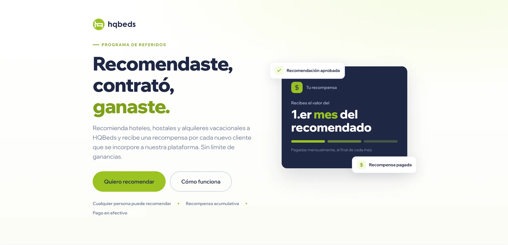
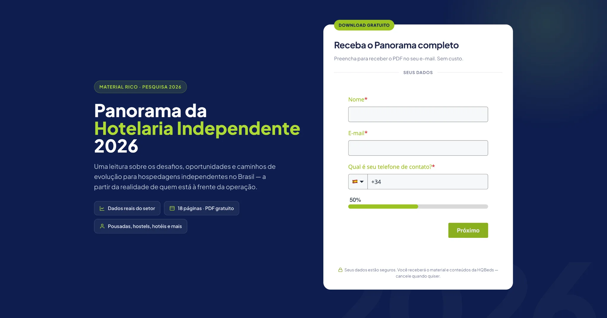
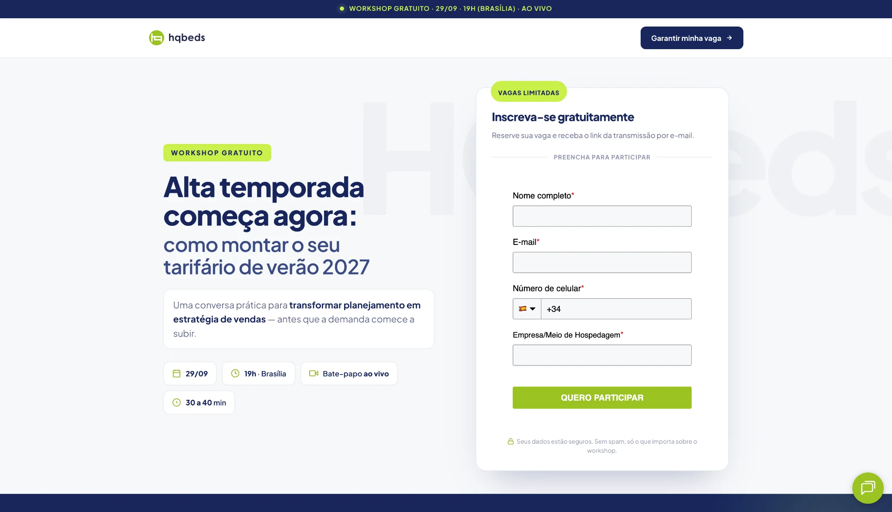

**🇺🇸 English** · [🇧🇷 Português](./README.pt-BR.md) · [🇪🇸 Español](./README.es.md)

# HQBeds — Web experiences & landing pages

### Conversion-focused development for hospitality

**Responsive interfaces · Multilingual experiences · Lead generation · UX/UI**

A collection of web projects by **Marcus Castro**, combining frontend development, content strategy, and business-oriented user journeys.

[Explore cases](#selected-work) · [Live websites](#selected-work) · [GitHub profile](https://github.com/marcuscastrodev)

> **Independent portfolio showcase.** HQBeds owns the original brand, web pages, and creative assets. This repository does not contain production code, credentials, customer information, or confidential performance data.

## About the work

These projects explore three different conversion journeys within the hospitality industry: **referrals**, **research-driven lead acquisition**, and **educational event registration**. Each landing page presents a distinct information architecture while keeping the user’s next action clear.

## Selected work

| Project | Focus | Live experience | Case study |
| :--- | :--- | :--- | :--- |
| **01 — Referral Program (PT/ES)** | Multilingual acquisition, conversion-focused messaging and reward explanation | [Português](https://conteudo.hqbeds.com.br/programa-de-indica%C3%A7%C3%A3o) · [Español](https://conteudo.hqbeds.com.br/es/programa-de-recomendacion) | [View case](case-studies/referral-program.md) |
| **02 — Independent Hospitality Report 2026** | Research storytelling, lead capture and content hierarchy | [Open page](https://www.hqbeds.com.br/panorama-da-hotelaria-independente-2026) | [View case](case-studies/hospitality-report-2026.md) |
| **03 — Summer Pricing 2027** | Educational workshop, registration and information design | [Open page](https://www.hqbeds.com.br/alta-temporada-comeca-agora--como-montar-seu-tarifario-de-verao-2027) | [View case](case-studies/summer-pricing-2027.md) |

**Three case studies, four public landing-page URLs.** The referral program includes Portuguese and Spanish variants.

## Visual walkthrough

### 01 — Referral Program

A localized referral journey combining a benefit-led hero, action-oriented CTAs, and a reward explanation. The Portuguese and Spanish experiences are documented together to highlight how messaging and presentation adapt across audiences.

[Read the referral case](case-studies/referral-program.md) · [Full screenshot gallery](screenshots/referral-program/)

### 02 — Independent Hospitality Report 2026

A research-led lead generation page that translates an industry report into a readable overview, supporting insights, and a download form.

[Read the report case](case-studies/hospitality-report-2026.md) · [Full screenshot gallery](screenshots/hospitality-report-2026/)

### 03 — Summer Pricing 2027

An educational campaign page that communicates a workshop offer through clear scheduling details, key topics, and registration elements.

[Read the workshop case](case-studies/summer-pricing-2027.md) · [Full screenshot gallery](screenshots/summer-pricing-2027/)

*The screenshots are genuine captures of the published landing-page interfaces. They do not represent measured campaign results.*

## What these projects demonstrate

- **Frontend and responsive UI:** information hierarchy, mobile considerations, interface consistency.
- **Conversion-focused UX:** offers, calls to action, supporting content and registration journeys.
- **Localization:** Portuguese and Spanish adaptations for a shared referral proposition.
- **Information architecture:** transforming complex research or educational content into clear page sections.
- **Marketing and product thinking:** aligning the interface with the business objective and user intent.

Implementation ownership, specific frameworks, form integrations, and measured results will be attributed only when verified.

## Documentation

- [Referral Program — PT/ES](case-studies/referral-program.md)
- [Independent Hospitality Report 2026](case-studies/hospitality-report-2026.md)
- [Summer Pricing 2027](case-studies/summer-pricing-2027.md)
- [Screenshot directory](screenshots/README.md)
- [Project notes and permissions](docs/project-notes.md)

## About the developer

I’m **Marcus Castro**, a web developer with a background in marketing strategy and project management. I build digital experiences with attention to interface quality, technical execution, and business goals.

[More projects on GitHub](https://github.com/marcuscastrodev) · [MOVA full-stack case](https://github.com/marcuscastrodev/mova-showcase)

---

*This portfolio repository is independently maintained and is not an official HQBeds source-code distribution.*
