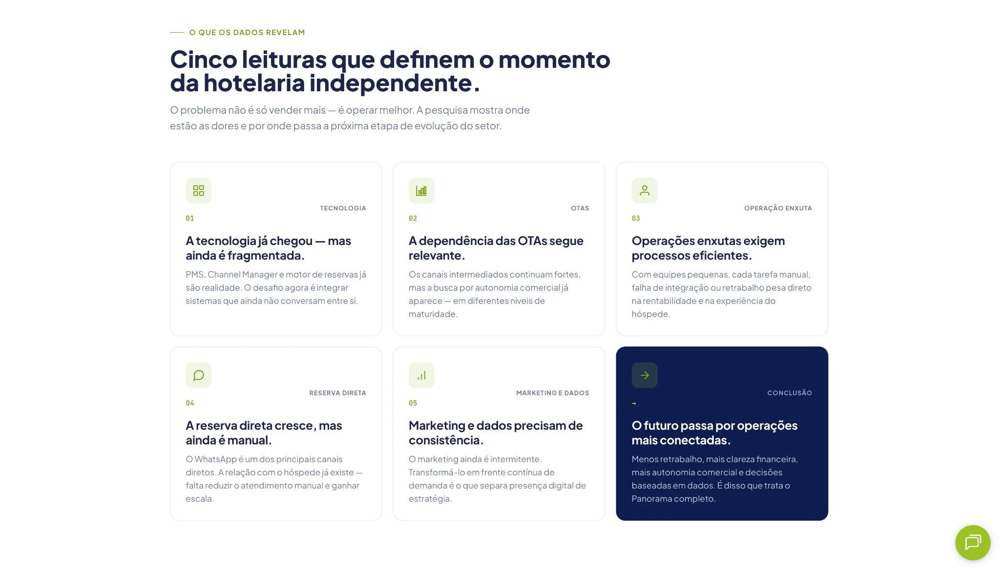
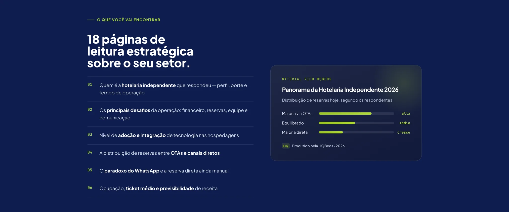

# Independent Hospitality Report 2026 | Research & Lead Generation

**Type:** Rich-content landing page · Research storytelling · Email lead capture

**Published page:** [Panorama da Hotelaria Independente 2026](https://www.hqbeds.com.br/panorama-da-hotelaria-independente-2026)

## Business challenge

Present a hospitality industry report clearly enough to establish its value and encourage visitors to request the full PDF.

## Observed experience

The screenshots supplied by the developer show three complementary page sections:

1. **Hero and form:** dark-navy background, high-contrast headline, explanatory copy, research highlights, and a prominent multi-step form with a visual progress indicator.
2. **Research takeaways:** a light section with five insight cards and a contrasting conclusion card, using consistent iconography and headings.
3. **Inside the report:** six numbered topics alongside a graphical preview of the research themes, switching to a dark background to create section rhythm.

The publicly accessible page also describes the report audience and repeats the download CTA.

## Implementation evidence

- The web page is built in HTML and displays responsive components and conversion-focused layouts.
- Its rendered markup exposes a **HubSpot portal identifier** near the form. This is evidence of a HubSpot-related embedded form component, but not proof that Marcus personally implemented that integration.
- The exact framework or CMS implementation, JavaScript modules, and third-party scripts must be verified against the source before claiming them.

## Visual gallery

### Research offer and lead form

The hero combines a research-led headline, key value points, and a prominent multi-step lead form.

### Key insights

A card-based section makes the report's main themes easier to scan.

### Inside the report

A numbered topic overview outlines the material's contents alongside a graphic summary.

*The captures illustrate the user interface; lead-generation results have not been independently verified.*

## Developer contribution

This case is attributed to Marcus Castro as portfolio work. Specific implementation responsibilities and any approved performance metrics can be added after verification.

[← Back to showcase](../README.md)
