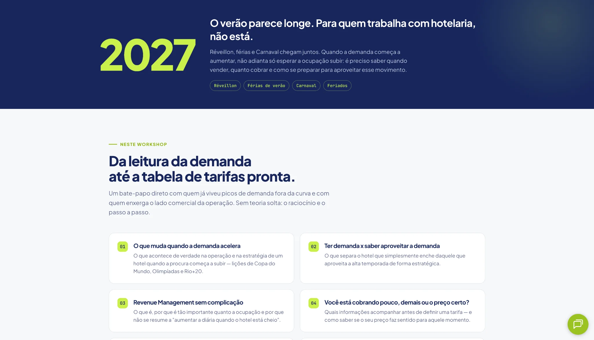

# Summer Pricing 2027 | Workshop Campaign Landing Page

**Type:** Event/workshop landing page · Educational campaign · Hospitality pricing

**Published page:** [Alta temporada começa agora: como montar seu tarifário de verão 2027](https://www.hqbeds.com.br/alta-temporada-comeca-agora--como-montar-seu-tarifario-de-verao-2027)

## Business challenge

Explain the value of a workshop about turning seasonal demand signals into concrete accommodation pricing decisions.

## Observed experience

The developer-provided screenshot confirms a **workshop agenda** section with:

- A prominent “Neste workshop” eyebrow and clear typographic hierarchy.
- Six numbered agenda cards organized in a two-column desktop grid.
- Topics including demand acceleration, revenue management, pricing strategy, seasonal segmentation, and missed revenue opportunities.
- Navy typography, lime-green numeric labels, white cards, and a soft gray background.

This is **not** documented as a generic article; the screenshot confirms an event/workshop-oriented content experience.

## Implementation evidence

The screenshot confirms layout and visual treatment, but it does not reveal the source framework, scripts, form behavior, or deployment details. The live page was not available for detailed automated inspection when this case was updated.

## Visual gallery

### Workshop hero and registration

A campaign-focused hero pairs the educational offer and scheduling information with a prominent registration form.

### Workshop topics

Numbered content cards break the learning agenda into scannable topics.

*The captures show the landing-page design; registration outcomes have not been independently verified.*

## Developer contribution

Marcus Castro identified the page as part of his HQBeds web development portfolio. Specific engineering ownership and measured outcomes will be documented when supported by source review.

[← Back to showcase](../README.md)
